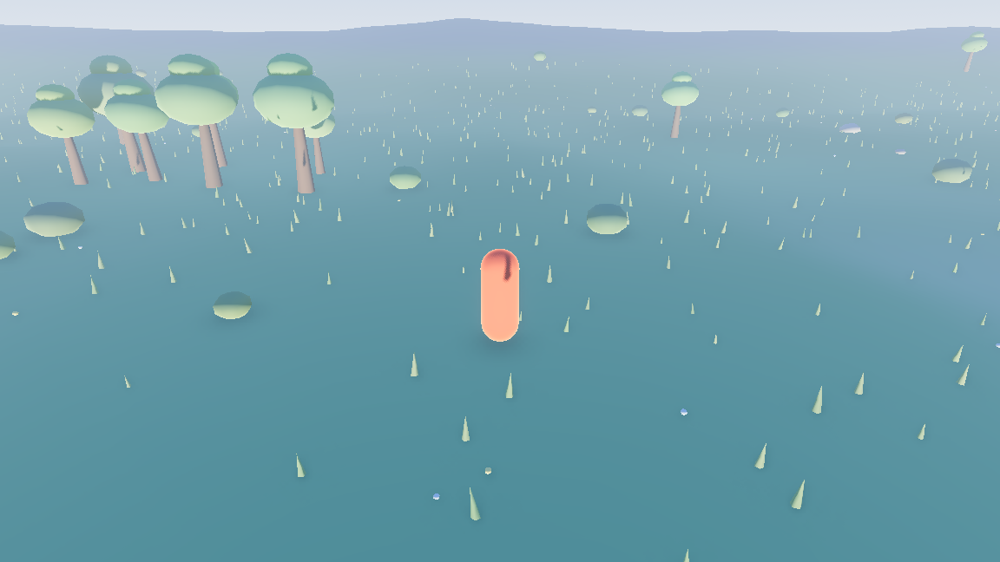
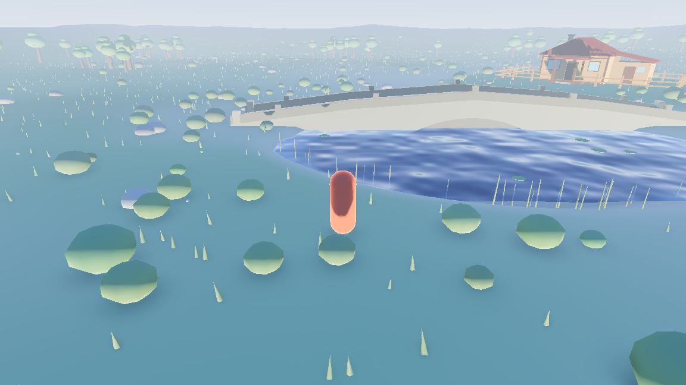
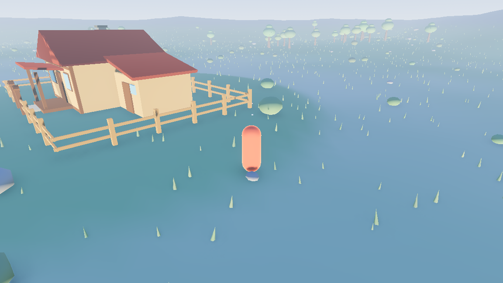

# Peace

一款 Godot 4 + 纯 C++（GDExtension）打造的治愈系 3D 探索小品：清晨的湖畔，木屋、石拱桥、果园与湿地。追逐昼夜与天气的变化，采浆果、开木箱、打井水、推门看屋——听鸟鸣、踩雪地，看月亮从满月到新月轮转。

**当前状态：可玩沙盒 v0.2.0** —— 玩法目标闭环与完整氛围世界均已可用，持续迭代中。

| 概览 | 石桥 | 宅基地 |
|------|------|--------|
|  |  |  |

更多截图（雪景/结冰/月相/HUD 特写）见 `docs/` 目录。面向玩家的玩法说明见 **[docs/PLAYING.md](docs/PLAYING.md)**。

- **引擎**：Godot 4.7.2 标准版（Forward+），不使用 .NET / C#
- **游戏逻辑**：纯 C++（GDExtension，godot-cpp 10.0）
- **目标平台**：macOS · Windows · Linux

---

## 游戏特色

- **程序化大地图**：固定种子生成 fbm 地形 + 湖盆 + 环山 + 宅基地压平；植被、浆果丛、蘑菇、倒木、碎石等全部 MultiMesh 散布，泥土小径与石拱桥全程程序化/CSG 搭建，无外部模型资产。
- **昼夜循环**：4 分钟一天，太阳/月亮运行、星空、HUD 时钟（时段/天气/月相/天数/气温）；月相按公式 8 天一轮转（第 1 天满月），月盘带陨石坑与暗面地照。
- **天气系统**：晴 / 多云 / 小雨 / 大雨 / 雪五态平滑过渡，雨雪粒子跟随主角。
- **分级积雪**：随雪量推进，湖面渐冻结冰（浅水先冻、冰面裂缝镜面反光），雪量近满可踏上大湖冰面滑行（移速 +65% 丝滑漂移），地面、贴地植被、树冠雪毯、蘑菇伞顶按海拔分档依次覆雪，低处先积雪。
- **水面着色器**：波浪、折射、深度吸收、菲涅尔、泡沫、焦散，雨天湖面涟漪、降温结冰；相机潜入水下后有青蓝水下氛围与声音低通（闷声效果）。
- **可交互物**：木屋门（推门前倾动画）、百叶窗、木箱、水井、菜畦（翻土播种，空畦旁按 R 换种浆果/萝卜/南瓜 → 井水浇灌助长 → 收获）、浆果丛（院里 3 丛 + 林缘 20 丛野生，采摘后 45 秒重新结果），准星提示 + E 键交互。
- **氛围生物**：鸟（雨天收翼不鸣）、兔子（夜晚回窝趴睡）、蝴蝶（四翅，雨雪静栖草丛）、湖面鸭群（绿头/褐头，绕湖缓游、尾迹水圈）、偶发鱼跃（跃水+涟漪+落水声）、萤火虫（晴夜飞舞）、蘑菇夜光、烟囱炊烟。
- **音效**：脚步声按地表切换草地/泥土/雪地/雨天湿泥/石板多种音色，开箱、踢球、放烟花、环境音（风/雨/鸟鸣/湖水/壁炉/BGM 八层）齐备——优先加载内置音频资产（提取自真实录音），资产缺失时运行期程序合成保底。
- **玩法目标**：每日待办清单——第 1 天采浆果引导，之后每天从 采浆果/钓鱼/足球进球/打井水/开木箱 五类确定性抽 3 项，全部完成回床睡觉进入新一天（GameDirector 跨天自动发布，SaveSystem 持续化）；钓上的鱼自动入图鉴（`B` 键查看累计与体长纪录，破纪录标 🏅）。

## 操作说明

| 按键 | 动作 |
|------|------|
| `W` `A` `S` `D` / `↑` `↓` | 移动（W 朝画面深处，随视角转向） |
| `←` `→` | 旋转视角（键盘转向，无需鼠标捕获即可用） |
| `空格` | 跳跃（空中可二段跳） |
| `E` | 互动（准星对准可交互对象出现提示时） |
| `R` | 滚动冲刺（空菜畦旁＝换种） |
| `F` | 钓鱼：湖边按住蓄力抛竿，控力条保持绿区把鱼拉上来 |
| `B` | 鱼获图鉴（小鱼/大鱼累计与最长体长纪录，持久保存） |
| `G` | 放烟花（夜晚） |
| `M` | 大地图 |
| `Esc` | 暂停菜单：继续 / 音量 / 画质（高/低）/ 全屏切换 / 保存并退出；大地图打开时只收起地图 |
| 鼠标 | 点击画面捕获视角，滚轮缩放距离 |

> 注：键位已收口至 project.godot `[input]` 段（物理键码，换布局不跑偏），C++ 侧经 InputMap 读取（`src/actors/player.cpp`）；动作缺失的极简场景自动退回硬编码键码兜底。

## 从源码运行

**依赖**：

- Godot 4.7.2 **标准版**（不要 .NET / mono 版）：[godotengine.org](https://godotengine.org/download) 或 `brew install --cask godot`
- Python 3 + SCons（`pip install scons`）
- git 子模块 godot-cpp

```bash
# 1) 一次性环境
git submodule update --init --recursive

# 2) 首次构建调试版动态库（会连带编译 godot-cpp，需几分钟）
scons platform=macos target=template_debug

# 3) 首次运行前必须无头导入一次工程资源（否则报 Cannot get class）
/Applications/Godot.app/Contents/MacOS/Godot --headless --editor --quit --path project

# 4) 运行游戏（或用编辑器打开 project/ 后按 F5）
/Applications/Godot.app/Contents/MacOS/Godot --path project
```

## 工程结构

```
3Dgame/
├── src/                        # C++ 游戏逻辑（全部玩法代码在这里）
│   ├── register_types.{h,cpp}  # GDExtension 入口：登记所有自定义类
│   ├── player.{h,cpp}          # 主角：移动/跳跃/相机/交互扫描/脚步声
│   ├── terrain_builder.{h,cpp} # 地形生成与全场景 MultiMesh 散布（固定种子）
│   ├── sky_cycle.{h,cpp}       # 昼夜/天气/月相驱动
│   ├── hud_clock.{h,cpp}       # HUD 时钟（时段/天气/月相/天数/气温）
│   ├── game_director.{h,cpp}   # 玩法目标与结算 HUD
│   ├── save_system.{h,cpp}     # 存档系统（user:// 配置文件，天数/进度恢复）
│   ├── ambience.{h,cpp}        # 环境音（风/雨/虫鸣/雪风，程序化合成）
│   ├── interactable.h          # 交互物抽象基类
│   ├── berry_bush / door / window / chest / well ...
│   └── bird / rabbit / butterfly_swarm ...   # 氛围生物
├── project/                    # Godot 工程（用编辑器打开这个目录）
│   ├── world.tscn              # 主场景（全场景搭建）
│   ├── export_presets.cfg      # 三平台导出预设（macOS / Windows / Linux）
│   ├── assets/*.gdshader       # 水面/植被风/雪地/月亮 等着色器
│   ├── assets/fonts/           # Noto Sans SC（中文 UI）
│   └── bin/game3d.gdextension  # 告诉 Godot 去哪里加载各平台 C++ 库
├── godot-cpp/                  # C++ 绑定（git 子模块，勿手改）
├── SConstruct                  # 构建脚本（SCons）
└── .github/workflows/          # build.yml 三平台库构建 · export.yml 三平台包导出
```

## 验证三连

改动代码后的快速自检：

```bash
# 1) 编译通过（无 error）
scons platform=macos target=template_debug

# 2) 无头跑 120 帧，应 0 报错
/Applications/Godot.app/Contents/MacOS/Godot --headless --path project --quit-after 120

# 3) 正常运行（默认画质偏重渲染，低配机器用暂停菜单切"画质：低"；帧率基线见 docs/PERF.md）
/Applications/Godot.app/Contents/MacOS/Godot --path project
```

## 导出发布

> **一键出包（推荐）**：`tools/package.sh` 已封装三平台交叉构建 + 导出 + 打包
> （macOS zip / Windows zip / Linux zip + .deb，产物落 `dist/`），支持 `--only=<平台>` 选择性出包与
> `--publish` 同步官网；日常发布直接用它，下述手动流程仅作原理参考。

1. 安装与编辑器版本一致的导出模板（编辑器菜单 → 管理导出模板，或手动放入
   `~/Library/Application Support/Godot/export_templates/4.7.2.stable/`）。
2. `project/export_presets.cfg` 已配置三平台预设（macOS / Windows / Linux），
   导出路径统一指向 `../release/`（macOS → `game3d.dmg`，Windows → `game3d.exe`，Linux → `game3d.x86_64`）。
3. 导出前需先构建对应平台的 **template_release** 动态库并就位
   `project/bin/<平台>/`（macOS 上手动构建当前平台即可；其他平台产物由
   GitHub Actions 流水线产出，不建议从 macOS 交叉编译）。
4. 命令行导出（或编辑器 → 项目 → 导出）。GDExtension 工程导出时 `.gdextension`
   会打包进 `Contents/Resources/*.pck`，对应动态库自动复制到
   `Contents/Frameworks/`，无需额外 resource filter：

```bash
/Applications/Godot.app/Contents/MacOS/Godot --headless --path project \
  --export-release "macOS" ../release/game3d.dmg
```

## 跨平台构建（CI）

三平台动态库由 `.github/workflows/build.yml` 构建（**手动触发**：Actions → build → Run workflow；私有库的 macOS runner 按 10 倍计费分钟消耗额度，因此不在 push/PR 时自动跑）：
在 `ubuntu-24.04` / `macos-latest` / `windows-latest` 三个 runner 上分别执行
`scons platform=<linux|macos|windows> target=template_release` 与 `target=template_debug`
各一次，并将 `project/bin/<平台>/` 上传为 artifact（`game3d-<平台>`）。
拿到各平台动态库后即可按上面第 3 步在对应平台执行导出。

| 平台 | 构建命令 | 动态库产物 |
|------|----------|-----------|
| macOS | `scons platform=macos` | `libgame3d.macos.template_*.dylib` |
| Windows | `scons platform=windows` | `game3d.windows.template_*.x86_64.dll` |
| Linux | `scons platform=linux` | `libgame3d.linux.template_*.x86_64.so` |

## 许可证

- 游戏代码：自研。
- 引擎：[Godot Engine](https://godotengine.org)（MIT License）。
- 工程模板结构源自 [godot-cpp-template](https://github.com/godotengine/godot-cpp-template)（MIT）。
- 内置字体 [Noto Sans SC](https://fonts.google.com/noto/specimen/Noto+Sans+SC)（SIL Open Font License 1.1，见 `project/assets/fonts/OFL.txt`）。
